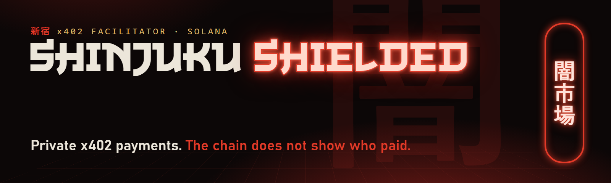

<p align="center"></p>

<p align="center">


<a href="https://github.com/ShinjukuStaition/shinjuku-mcp"></a>
</p>

# Shinjuku Shielded

Shinjuku Shielded is a privacy-only x402 payment facilitator on Solana.
An agent pays an x402 endpoint from a balance that it holds itself. The
chain does not show who paid.

- **Privacy-only.** We do not offer a cheaper path that is not private.
- **You keep your keys.** The wallet makes your keys on your machine. We
  never hold them, and we never hold your money.
- **We relay and pay the fees.** Our relayer sends your relayed deposits and
  exits and pays their network fees. Our facilitator pays the network fee of
  each payment that it settles.
- **One balance.** Your Shinjuku Shielded balance is a set of redeemable
  notes that you hold. The wallet shows it as one number.
- **Outside sellers work.** Any Solana x402 `exact` seller that takes USDC
  gets paid, whichever facilitator it uses (Coinbase CDP, PayAI, or any
  other). The seller changes nothing. Your wallet pays us privately, and we
  pay the seller from our own float. The chain shows Shinjuku paying the
  seller, never your wallet.

## Use it from your agent: Shinjuku Shielded MCP

Give Claude, Cursor, or any MCP host the facilitator directly: shield USDC,
pay x402 URLs from the shielded balance, and unshield, under caps that only
you set. Setup: [ShinjukuStaition/shinjuku-mcp](https://github.com/ShinjukuStaition/shinjuku-mcp).

## Docs

- [How it works](docs/how-it-works.md): x402, our three schemes, the flow
  of one payment, and what runs where.
- [Privacy model](docs/privacy-model.md): what the chain, the seller, our
  facilitator, the RPC, and the MCP host see, with each limit.
- [Sell with Shinjuku Shielded](docs/sell-with-shinjuku.md): get paid by
  Shinjuku Shielded buyers with stock x402 middleware, and get listed.
- [Proof](docs/proof.md): live mainnet transactions, and what each one shows
  and hides.
- [FAQ](docs/faq.md): custody, cost, networks, Tor, recovery, and audits.
- [Changelog](CHANGELOG.md): what changed in each wallet release up to
  `08a4b56f` (npm 0.3.8). Later releases, to the current npm 0.3.86:
  the [shinjuku-mcp changelog](https://github.com/ShinjukuStaition/shinjuku-mcp/blob/main/CHANGELOG.md).
- [Shinjuku Shielded MCP](https://github.com/ShinjukuStaition/shinjuku-mcp):
  give your agent the wallet as tools.

## Which endpoints you can pay

- **A seller whose 402 offers `shielded-exact`.** The wallet pays it from
  your shielded balance, and our facilitator settles the payment.
- **Any other Solana x402 `exact` endpoint that takes USDC, whichever
  facilitator settles it (float pay).** `pay` (or the MCP `x402_pay`) pays
  us privately from your shielded balance: the seller's price plus a flat
  fee of 0.001 USDC. We then pay the seller at once from our own shared
  float. You fill nothing and set nothing aside. If the seller does not take
  the payment, we refund price and fee to your shielded balance by ourselves.
  This path, and every other payment, needs wallet release `08a4b56f` (npm
  `shinjuku-shielded@0.3.8`) or later: the pool program was upgraded on
  2026-10-11, and earlier releases refuse to pay.

The largest price that float pay can pay for one request is the size of our
largest float pocket. Read it, and the fee, before you pay:

```sh
curl -fsS https://pay.shinjukustaition.com/api/x402/float/config
```

`feeAtomic` is the fee and `largestAtomic` is the largest price, in atomic
USDC (1000000 = 1 USDC). On 2026-10-22 they were `1000` (0.001 USDC) and
`10000000` (10 USDC). A higher price is refused before anything is paid
(`p03_float_price_above_capacity`).

The 3D market game [Shinjuku Undermarket](https://shinjukustaition.com) is
our first customer and our live demo.

This repository holds documentation and the published SHA-256 hashes of the
wallet file and its proof tools. It holds no server code, no circuit code,
and no wallet source code.

## Status

- Stable version (pinned 2026-10-23): wallet release `b650bf06`, npm
  `shinjuku-shielded@0.3.86` (the same files as `shinjuku-shield@0.3.86`; the
  terminal command is `shinjuku@0.3.86`). Install that exact version. It adds
  private AI in the terminal and for agent apps, and the `shinjuku` command.
  Every feature and how to use it: the
  [0.3.86 release notes](https://github.com/ShinjukuStaition/shinjuku-mcp#release-0386).
  Hash: the `b650bf06` row of [Releases](#releases).
- The stable version before it: wallet release `98296ff0` (npm 0.3.80).
- Candidate (2026-10-24, not the stable version): wallet release `af5b54d5`, npm
  `shinjuku-shield@0.3.94` under the tag `next`. It fixes known issues 1 to 7 of 0.3.86,
  shows a QR code for a deposit, takes any amount from 0.01 USDC in a terminal, keeps
  every tool text short enough for agent apps to read in full, asks "Use Tor?"
  when an agent app sets up the wallet, and waits for your answer in the setup box.
- `shielded-exact` payments from the shielded balance: live on mainnet.
- Float pay to any Solana x402 `exact` endpoint that takes USDC: live on
  mainnet since 2026-10-11 (wallet release `e3348092` and later). On
  2026-10-11 it paid two stock sellers on the PayAI facilitator, 0.10 USDC in
  15 s and 1.50 USDC in 20 s, and a stock seller on our own facilitator
  (`488372b4` and later), 0.01 USDC in 16 s and 17 s: see
  [proof.md](docs/proof.md).
- Faster pool anchors: live on mainnet since the pool program upgrade of
  2026-10-11 (wallet release `08a4b56f` and later). The pool takes an anchor
  about every 30 s when it grew. In our test, 12 of 12 new accounts could pay
  within 45 s (median 18 s).
- Pool moves: live from wallet release `701809bd` (npm `shinjuku-shielded@0.3.9`). When we open a new
  pool, the old pool keeps serving until it is empty, and `move` moves your
  whole balance to the new pool privately: you pay our float in the old pool, and the float pays you
  in the new pool. Nothing goes through a public account.
- Per-user pockets: replaced by float pay. The wallet fills no new pocket
  for a payment. `pocket reshield` returns the USDC of an old pocket to your
  shielded balance.
- Hidden amounts (scheme `confidential`, the V0b vault): retired. The V0b
  program was closed on chain on 2026-10-11.
- The wallet file and its proof tools, served from our site and our onion
  service with SHA-256 hashes: live.
- Key ceremonies: a multi-party ceremony: not yet.
- Independent audit: none yet.

## Releases

Each release is one file, `shinjuku-wallet.mjs`, and a set of proof tools.
Our website serves the files and their SHA-256 hashes at
`https://shinjukustaition.com/wallet/<sha8>/` and
`https://shinjukustaition.com/proof-tools/<sha8>/`. This repository is a
second, separate place for those hashes: each release adds its row here.

The stable version is `b650bf06`, on npm as `shinjuku-shielded@0.3.86` and
`shinjuku-shield@0.3.86` (pinned 2026-10-23). Use it for a new install. A row marked "candidate" is a newer
release served beside the stable version and published on npm under the
tag `next`, not `latest`; it becomes the stable version only when we say so here. Rows
marked "no longer served" are gone from the website; the other older rows
stay for the record. Some short-lived releases served between 2026-10-05 and
2026-10-07 have no row here. What changed in each release after `08a4b56f`
is in the [shinjuku-mcp changelog](https://github.com/ShinjukuStaition/shinjuku-mcp/blob/main/CHANGELOG.md).

| Released (UTC) | Wallet release | Wallet file SHA-256 | Bytes | Proof tools | SHA-256 of the proof-tools file list | Proof-tools files |
|---|---|---|---|---|---|---|
| 2026-10-02 | `68aac3c1` (no longer served) | `68aac3c1f7bcf9e21c44637c5db4cef3ad8ed52732cd5634f0884d1417a78b1d` | 9,476,013 | [`864898cb`](https://shinjukustaition.com/proof-tools/864898cb/SHA256SUMS) | `864898cb1a7db74c54bc567307795ba154f2b8ed70e36a1336bf8c6c06c5c702` | 29 (183,830,695 bytes) |
| 2026-10-05 | `f561eccf` (no longer served) | `f561eccf5c357731d9be5bc06a02accbc52e6368dd95ce95efb85542c039acc7` | 9,548,479 | [`864898cb`](https://shinjukustaition.com/proof-tools/864898cb/SHA256SUMS) | `864898cb1a7db74c54bc567307795ba154f2b8ed70e36a1336bf8c6c06c5c702` | 29 (183,830,695 bytes) |
| 2026-10-07 | `833aeed3` (no longer served) | `833aeed35eca3ad85a9b8b949b2452945a071081765677060c509fd786976ff4` | 9,602,171 | [`c777fa3e`](https://shinjukustaition.com/proof-tools/c777fa3e/SHA256SUMS) | `c777fa3eac5f874d0b8b07a4ed352ece37825412b9dfde206222f66a31a12252` | 29 (184,817,703 bytes) |
| 2026-10-07 | `cbd97cea` (no longer served) | `cbd97cea4c71cdf0b27df3b59d687cd65e4b6d93965e36a6a8f3f5a525c12c42` | 9,798,568 | [`c777fa3e`](https://shinjukustaition.com/proof-tools/c777fa3e/SHA256SUMS) | `c777fa3eac5f874d0b8b07a4ed352ece37825412b9dfde206222f66a31a12252` | 29 (184,817,703 bytes) |
| 2026-10-07 | `c0fb991f` (no longer served) | `c0fb991f0a59133c389486af11b40f0565732331152b9b8b82a84e62999d9bc3` | 9,932,761 | [`c777fa3e`](https://shinjukustaition.com/proof-tools/c777fa3e/SHA256SUMS) | `c777fa3eac5f874d0b8b07a4ed352ece37825412b9dfde206222f66a31a12252` | 29 (184,817,703 bytes) |
| 2026-10-07 | `a66228ab` (no longer served) | `a66228aba12d70e4f2cfc0fa83122bb09073bbd5734aec74a0b16ddebad044a9` | 9,937,880 | [`82b2d870`](https://shinjukustaition.com/proof-tools/82b2d870/SHA256SUMS) | `82b2d8709f28cfdd65c9a03707af4811b8d6e77b1231b4e1de6dd2d84f209c3b` | 26 (144,319,243 bytes) |
| 2026-10-07 | `c7abfaaf` (no longer served) | `c7abfaafb1fbcdae82adeb927b4322d79582cd45af5410f5af532141e2d74004` | 9,944,079 | [`82b2d870`](https://shinjukustaition.com/proof-tools/82b2d870/SHA256SUMS) | `82b2d8709f28cfdd65c9a03707af4811b8d6e77b1231b4e1de6dd2d84f209c3b` | 26 (144,319,243 bytes) |
| 2026-10-07 | `0a638498` (no longer served) | `0a6384984b20f971739f29ba3b7d1d54ff9f0861e79f330b7018812c06ba5e08` | 9,947,337 | [`82b2d870`](https://shinjukustaition.com/proof-tools/82b2d870/SHA256SUMS) | `82b2d8709f28cfdd65c9a03707af4811b8d6e77b1231b4e1de6dd2d84f209c3b` | 26 (144,319,243 bytes) |
| 2026-10-07 | `33d54d54` (no longer served) | `33d54d540882fdbe8d2cfaf85cfee3a34084f6de6f30a0ee7416f1996fb1f176` | 9,949,930 | [`82b2d870`](https://shinjukustaition.com/proof-tools/82b2d870/SHA256SUMS) | `82b2d8709f28cfdd65c9a03707af4811b8d6e77b1231b4e1de6dd2d84f209c3b` | 26 (144,319,243 bytes) |
| 2026-10-07 | `551f8ad9` (no longer served) | `551f8ad94c8a9eb17edd1322c22381e30b363d6e9478869ca92ee753162356ce` | 9,959,998 | [`82b2d870`](https://shinjukustaition.com/proof-tools/82b2d870/SHA256SUMS) | `82b2d8709f28cfdd65c9a03707af4811b8d6e77b1231b4e1de6dd2d84f209c3b` | 26 (144,319,243 bytes) |
| 2026-10-07 | `dc92be17` (no longer served) | `dc92be17c691b053e6a63e7b60c64d08952e56b375d8fb9010e735083d200562` | 9,994,933 | [`82b2d870`](https://shinjukustaition.com/proof-tools/82b2d870/SHA256SUMS) | `82b2d8709f28cfdd65c9a03707af4811b8d6e77b1231b4e1de6dd2d84f209c3b` | 26 (144,319,243 bytes) |
| 2026-10-07 | `bf2652a3` (no longer served) | `bf2652a341042f419a2dd63157bc82f354a63d01652ebb62f265540f77d71d0d` | 9,997,344 | [`82b2d870`](https://shinjukustaition.com/proof-tools/82b2d870/SHA256SUMS) | `82b2d8709f28cfdd65c9a03707af4811b8d6e77b1231b4e1de6dd2d84f209c3b` | 26 (144,319,243 bytes) |
| 2026-10-07 | `6909057a` (no longer served) | `6909057a6992ed86c302318cee394e8aa93bb27a7b4d006a0cf6f170939fd95c` | 10,000,534 | [`82b2d870`](https://shinjukustaition.com/proof-tools/82b2d870/SHA256SUMS) | `82b2d8709f28cfdd65c9a03707af4811b8d6e77b1231b4e1de6dd2d84f209c3b` | 26 (144,319,243 bytes) |
| 2026-10-07 | `c6afbdbe` (no longer served) | `c6afbdbe7e3da1d159a3f90af4ab1524a4397ca52f8d1668e5437ad10d026aaa` | 10,041,883 | [`82b2d870`](https://shinjukustaition.com/proof-tools/82b2d870/SHA256SUMS) | `82b2d8709f28cfdd65c9a03707af4811b8d6e77b1231b4e1de6dd2d84f209c3b` | 26 (144,319,243 bytes) |
| 2026-10-07 | `3765885f` (no longer served) | `3765885f2f9fdab66250967a4f3392708177f10c3feb7efd1f0e05cbbda39a8a` | 10,083,253 | [`82b2d870`](https://shinjukustaition.com/proof-tools/82b2d870/SHA256SUMS) | `82b2d8709f28cfdd65c9a03707af4811b8d6e77b1231b4e1de6dd2d84f209c3b` | 26 (144,319,243 bytes) |
| 2026-10-07 | `97d6703d` (no longer served) | `97d6703d6e3060fc07e00453022cdd800a7a67854a3be19d056c6993aed59a6b` | 10,085,139 | [`82b2d870`](https://shinjukustaition.com/proof-tools/82b2d870/SHA256SUMS) | `82b2d8709f28cfdd65c9a03707af4811b8d6e77b1231b4e1de6dd2d84f209c3b` | 26 (144,319,243 bytes) |
| 2026-10-07 | `721b8d65` (no longer served) | `721b8d6561911e580597559df09d3dbad0cee28b234204e1b58cc60634a464b9` | 10,086,778 | [`82b2d870`](https://shinjukustaition.com/proof-tools/82b2d870/SHA256SUMS) | `82b2d8709f28cfdd65c9a03707af4811b8d6e77b1231b4e1de6dd2d84f209c3b` | 26 (144,319,243 bytes) |
| 2026-10-07 | `061adadb` (no longer served) | `061adadb83970c5954fbca5a7650c7d48644df10bdeed01795bf256a59a94c71` | 10,087,516 | [`82b2d870`](https://shinjukustaition.com/proof-tools/82b2d870/SHA256SUMS) | `82b2d8709f28cfdd65c9a03707af4811b8d6e77b1231b4e1de6dd2d84f209c3b` | 26 (144,319,243 bytes) |
| 2026-10-07 | `b4c514cd` (no longer served) | `b4c514cdd74db9644478f804eb0f44274843916196f0be140b7788906d56ab0d` | 10,087,976 | [`82b2d870`](https://shinjukustaition.com/proof-tools/82b2d870/SHA256SUMS) | `82b2d8709f28cfdd65c9a03707af4811b8d6e77b1231b4e1de6dd2d84f209c3b` | 26 (144,319,243 bytes) |
| 2026-10-07 | `768001dd` (no longer served) | `768001dd1107bfa2bdcfaaffb53b791591a8b9e2c012889ce14b615a30b49ee7` | 10,098,493 | [`82b2d870`](https://shinjukustaition.com/proof-tools/82b2d870/SHA256SUMS) | `82b2d8709f28cfdd65c9a03707af4811b8d6e77b1231b4e1de6dd2d84f209c3b` | 26 (144,319,243 bytes) |
| 2026-10-07 | `57bfd2fd` (no longer served) | `57bfd2fd31e127d7bcfdbd11f067cb34085d23f6938be0daf3a106bd7226fb40` | 10,101,617 | [`82b2d870`](https://shinjukustaition.com/proof-tools/82b2d870/SHA256SUMS) | `82b2d8709f28cfdd65c9a03707af4811b8d6e77b1231b4e1de6dd2d84f209c3b` | 26 (144,319,243 bytes) |
| 2026-10-08 | `565c4f87` (no longer served) | `565c4f8710070da6e604d0fa5a25f3147ae5dc9826bbc556e51113abce8c5276` | 10,107,045 | [`82b2d870`](https://shinjukustaition.com/proof-tools/82b2d870/SHA256SUMS) | `82b2d8709f28cfdd65c9a03707af4811b8d6e77b1231b4e1de6dd2d84f209c3b` | 26 (144,319,243 bytes) |
| 2026-10-08 | `63316238` (no longer served) | `633162382f09c72a48eb6d1fc21a0e09a9b5e4d920da5e74ab6eb018e6dcaf85` | 10,110,248 | [`82b2d870`](https://shinjukustaition.com/proof-tools/82b2d870/SHA256SUMS) | `82b2d8709f28cfdd65c9a03707af4811b8d6e77b1231b4e1de6dd2d84f209c3b` | 26 (144,319,243 bytes) |
| 2026-10-08 | `b7d6f394` (no longer served) | `b7d6f394211c9d08ad158dc5e31495f31391c4dc5a9a60dc57a3773e443ba133` | 10,149,069 | [`82b2d870`](https://shinjukustaition.com/proof-tools/82b2d870/SHA256SUMS) | `82b2d8709f28cfdd65c9a03707af4811b8d6e77b1231b4e1de6dd2d84f209c3b` | 26 (144,319,243 bytes) |
| 2026-10-08 | `c4a50798` (no longer served) | `c4a50798e53cdde49c34a51ab16143d095278e1477eedcf0a72bc6f83ac61042` | 10,154,630 | [`82b2d870`](https://shinjukustaition.com/proof-tools/82b2d870/SHA256SUMS) | `82b2d8709f28cfdd65c9a03707af4811b8d6e77b1231b4e1de6dd2d84f209c3b` | 26 (144,319,243 bytes) |
| 2026-10-08 | `2c2f9874` (no longer served) | `2c2f9874f95619ef291f89fa88158b97d2125198a12abe8ecade9d6c2e9f10fc` | 10,175,816 | [`82b2d870`](https://shinjukustaition.com/proof-tools/82b2d870/SHA256SUMS) | `82b2d8709f28cfdd65c9a03707af4811b8d6e77b1231b4e1de6dd2d84f209c3b` | 26 (144,319,243 bytes) |
| 2026-10-08 | `1a336885` (no longer served) | `1a3368854f4bdfe185a2ac398106c9b39a7148225f1a3ec6a6dcead563c7ed53` | 10,176,434 | [`82b2d870`](https://shinjukustaition.com/proof-tools/82b2d870/SHA256SUMS) | `82b2d8709f28cfdd65c9a03707af4811b8d6e77b1231b4e1de6dd2d84f209c3b` | 26 (144,319,243 bytes) |
| 2026-10-08 | `11fe6b40` (no longer served) | `11fe6b40661d3af5e7fe50a20603a1efde4d0997fc243fb16709daad94fd8d29` | 10,289,404 | [`24e819a8`](https://shinjukustaition.com/proof-tools/24e819a8/SHA256SUMS) | `24e819a86928a3da7b2f0d297237f6411129cc0cccffbc77d92461022e617da0` | 26 (144,322,131 bytes) |
| 2026-10-08 | `94a357bc` (no longer works: pool program upgraded) | `94a357bc22e57592fde37c3a98a4a79a79d031ea5f1ab90261d2f25d7ad85aec` | 10,438,545 | [`262e1e98`](https://shinjukustaition.com/proof-tools/262e1e98/SHA256SUMS) | `262e1e98f871a12dbd7f3d6a41350982a098109e7e7356e44e854b96dac73f24` | 26 (144,322,131 bytes) |
| 2026-10-08 | `a8516e49` (no longer works: pool program upgraded) | `a8516e499a99fb8c0157cbdf5321ed3e9352d4511707b5ccc39e12277771c529` | 10,438,942 | [`262e1e98`](https://shinjukustaition.com/proof-tools/262e1e98/SHA256SUMS) | `262e1e98f871a12dbd7f3d6a41350982a098109e7e7356e44e854b96dac73f24` | 26 (144,322,131 bytes) |
| 2026-10-08 | `d2a7291f` (no longer works: pool program upgraded) | `d2a7291f11d583fab55b39ab67cc820808e5c7607618d1456c70cda34eb3450f` | 10,441,804 | [`262e1e98`](https://shinjukustaition.com/proof-tools/262e1e98/SHA256SUMS) | `262e1e98f871a12dbd7f3d6a41350982a098109e7e7356e44e854b96dac73f24` | 26 (144,322,131 bytes) |
| 2026-10-09 | `36d0219d` (no longer works: stale proof-tools pin) | `36d0219d0ccb169ff0dc6d81d60a0437c10e7c26d9878fe673d86cc4043fb581` | 10,759,010 | [`a9f18f88`](https://shinjukustaition.com/proof-tools/a9f18f88/SHA256SUMS) | `a9f18f88d1999f50f1c589ec80c746fda634262c7051a5e7d76c534fe9431db8` | 26 (144,324,423 bytes) |
| 2026-10-09 | `14dd9efa` (no longer works: pool AAG16 retired) | `14dd9efa7c6bbd2906a56e732a4aff9d23c7b867b6fd9fec4f005494acc3823b` | 10,759,068 | [`9975fdf8`](https://shinjukustaition.com/proof-tools/9975fdf8/SHA256SUMS) | `9975fdf857298f5fcb82feba64400b21faca0bad846c61e9126b9a0663d430be` | 26 (144,324,423 bytes) |
| 2026-10-10 | `f2ea6840` (no longer served) | `f2ea684051a96e03ea86d998ad5b2f4033de55fce3a4f9695376e611884fdbc6` | 10,788,620 | [`ad860e62`](https://shinjukustaition.com/proof-tools/ad860e62/SHA256SUMS) | `ad860e62dd9bde09008fce798dbe0970f59ef9f7fca846e5a5238c93d7f42597` | 26 (144,319,242 bytes) |
| 2026-10-11 | `e3348092` (no longer served) | `e3348092deb29664a3496827f72bdd6dafc9f5f67f41b463da4c2bc84432cfac` | 10,846,173 | [`ad860e62`](https://shinjukustaition.com/proof-tools/ad860e62/SHA256SUMS) | `ad860e62dd9bde09008fce798dbe0970f59ef9f7fca846e5a5238c93d7f42597` | 26 (144,319,242 bytes) |
| 2026-10-11 | `9f9b4039` (no longer served) | `9f9b4039a044f74189b8a1a932c489c9653c1cdd3609d6b062363ced61ca30c6` | 10,814,984 | [`ad860e62`](https://shinjukustaition.com/proof-tools/ad860e62/SHA256SUMS) | `ad860e62dd9bde09008fce798dbe0970f59ef9f7fca846e5a5238c93d7f42597` | 26 (144,319,242 bytes) |
| 2026-10-11 | `488372b4` (no longer works: stale program pin) | `488372b4f12886748870eb5fb6d5f25eb42a43b6ddc6f74c20cac033fe5f6927` | 10,818,483 | [`ad860e62`](https://shinjukustaition.com/proof-tools/ad860e62/SHA256SUMS) | `ad860e62dd9bde09008fce798dbe0970f59ef9f7fca846e5a5238c93d7f42597` | 26 (144,319,242 bytes) |
| 2026-10-11 | `19542942` (no longer served) | `195429425616ad43e2e4bbb61e31da7b25bd74b30301b28ae4f4aa18a08250b1` | 10,818,483 | [`47678912`](https://shinjukustaition.com/proof-tools/47678912/SHA256SUMS) | `47678912949d7da8b705c399edf03d2367465f6eb581b00a059356373baed28e` | 26 (144,322,174 bytes) |
| 2026-10-11 | `394d020a` (no longer served) | `394d020a4183ea7ff50282001e5f37cd5d5602822ef468df72569a0c3292061e` | 10,819,973 | [`47678912`](https://shinjukustaition.com/proof-tools/47678912/SHA256SUMS) | `47678912949d7da8b705c399edf03d2367465f6eb581b00a059356373baed28e` | 26 (144,322,174 bytes) |
| 2026-10-11 | [`08a4b56f`](https://shinjukustaition.com/wallet/08a4b56f/shinjuku-wallet.mjs) | `08a4b56f6452268ffdd513e67326de8782b53dcec16ba88adaddf16793581206` | 10,822,047 | [`47678912`](https://shinjukustaition.com/proof-tools/47678912/SHA256SUMS) | `47678912949d7da8b705c399edf03d2367465f6eb581b00a059356373baed28e` | 26 (144,322,174 bytes) |
| 2026-10-12 | [`701809bd`](https://shinjukustaition.com/wallet/701809bd/shinjuku-wallet.mjs) | `701809bdf80ea16a9d16105f067998029d2a0f03d69b885720a08d806eae30d4` | 10,943,907 | [`47678912`](https://shinjukustaition.com/proof-tools/47678912/SHA256SUMS) | `47678912949d7da8b705c399edf03d2367465f6eb581b00a059356373baed28e` | 26 (144,322,174 bytes) |
| 2026-10-12 | [`28f33853`](https://shinjukustaition.com/wallet/28f33853/shinjuku-wallet.mjs) | `28f33853062c9982283f59bef13a6bb33b6ce474ea62c0d30ae6e0d473e66da2` | 10,945,718 | [`5bed238f`](https://shinjukustaition.com/proof-tools/5bed238f/SHA256SUMS) | `5bed238f3696208ca3a8e66d206e5fffc85f1823e959abe1901c2d57c17bcdf3` | 26 (144,319,242 bytes) |
| 2026-10-12 | [`a9b9ea19`](https://shinjukustaition.com/wallet/a9b9ea19/shinjuku-wallet.mjs) | `a9b9ea19ca82a7e4fe991f01050aae148bea45db0bb46be31c22df310e081969` | 10,949,292 | [`5bed238f`](https://shinjukustaition.com/proof-tools/5bed238f/SHA256SUMS) | `5bed238f3696208ca3a8e66d206e5fffc85f1823e959abe1901c2d57c17bcdf3` | 26 (144,319,242 bytes) |
| 2026-10-13 | [`d769dad3`](https://shinjukustaition.com/wallet/d769dad3/shinjuku-wallet.mjs) | `d769dad321e1a1f88e0557c65b56336b2d6356fbd0167bc0f4acbed55793b27a` | 11,120,051 | [`5fa83692`](https://shinjukustaition.com/proof-tools/5fa83692/SHA256SUMS) | `5fa8369234088b532977254d91109e7eced3aef0228b9ed55c7c8a02e0a9a908` | 26 (144,322,314 bytes) |
| 2026-10-13 | [`d2ba7e62`](https://shinjukustaition.com/wallet/d2ba7e62/shinjuku-wallet.mjs) | `d2ba7e62eff143df57466d5f0ba534856e29c88007eafc22c3dfaeb89535eadb` | 11,120,794 | [`5fa83692`](https://shinjukustaition.com/proof-tools/5fa83692/SHA256SUMS) | `5fa8369234088b532977254d91109e7eced3aef0228b9ed55c7c8a02e0a9a908` | 26 (144,322,314 bytes) |
| 2026-10-13 | [`db079e37`](https://shinjukustaition.com/wallet/db079e37/shinjuku-wallet.mjs) | `db079e3700b17388873252fb91358d1918801ff69d1ee26f4e3e9f21bccbab34` | 11,121,670 | [`5fa83692`](https://shinjukustaition.com/proof-tools/5fa83692/SHA256SUMS) | `5fa8369234088b532977254d91109e7eced3aef0228b9ed55c7c8a02e0a9a908` | 26 (144,322,314 bytes) |
| 2026-10-13 | [`6a87b0a1`](https://shinjukustaition.com/wallet/6a87b0a1/shinjuku-wallet.mjs) | `6a87b0a15ec5979313adc3e9b7f19e239c2f14af1c46565e958054dbc60e8af7` | 11,122,024 | [`5fa83692`](https://shinjukustaition.com/proof-tools/5fa83692/SHA256SUMS) | `5fa8369234088b532977254d91109e7eced3aef0228b9ed55c7c8a02e0a9a908` | 26 (144,322,314 bytes) |
| 2026-10-13 | [`b32bffc7`](https://shinjukustaition.com/wallet/b32bffc7/shinjuku-wallet.mjs) | `b32bffc727e1e7e33fb134a3918638006259033511e1a2aaf455d037da1f70b3` | 11,124,201 | [`5fa83692`](https://shinjukustaition.com/proof-tools/5fa83692/SHA256SUMS) | `5fa8369234088b532977254d91109e7eced3aef0228b9ed55c7c8a02e0a9a908` | 26 (144,322,314 bytes) |
| 2026-10-13 | [`2ec5cd82`](https://shinjukustaition.com/wallet/2ec5cd82/shinjuku-wallet.mjs) | `2ec5cd82c2ae8b9008491d07b5dc4740a5db5904e92814870fd66080aec7fc7b` | 11,113,178 | [`5fa83692`](https://shinjukustaition.com/proof-tools/5fa83692/SHA256SUMS) | `5fa8369234088b532977254d91109e7eced3aef0228b9ed55c7c8a02e0a9a908` | 26 (144,322,314 bytes) |
| 2026-10-13 | [`6adb4430`](https://shinjukustaition.com/wallet/6adb4430/shinjuku-wallet.mjs) | `6adb44302a8db0b19245a1366e56090c0f0d27c443f37e69c1c2ef97151c9e74` | 11,115,097 | [`5fa83692`](https://shinjukustaition.com/proof-tools/5fa83692/SHA256SUMS) | `5fa8369234088b532977254d91109e7eced3aef0228b9ed55c7c8a02e0a9a908` | 26 (144,322,314 bytes) |
| 2026-10-14 | [`8b897dc9`](https://shinjukustaition.com/wallet/8b897dc9/shinjuku-wallet.mjs) | `8b897dc95ce8c17c9b0730c6ca5fddaf727b315d054489154d30bd795692a390` | 11,127,328 | [`5fa83692`](https://shinjukustaition.com/proof-tools/5fa83692/SHA256SUMS) | `5fa8369234088b532977254d91109e7eced3aef0228b9ed55c7c8a02e0a9a908` | 26 (144,322,314 bytes) |
| 2026-10-14 | [`c1963de1`](https://shinjukustaition.com/wallet/c1963de1/shinjuku-wallet.mjs) | `c1963de19cc61973bc35d2d55284b771db5846c323419f771e342f9cd3052e57` | 11,128,106 | [`5fa83692`](https://shinjukustaition.com/proof-tools/5fa83692/SHA256SUMS) | `5fa8369234088b532977254d91109e7eced3aef0228b9ed55c7c8a02e0a9a908` | 26 (144,322,314 bytes) |
| 2026-10-14 | [`79f40d94`](https://shinjukustaition.com/wallet/79f40d94/shinjuku-wallet.mjs) | `79f40d948e80ecdbe29b67d336b971ecc50c3f6b220349e0915ff7d8cae7178d` | 11,130,649 | [`5fa83692`](https://shinjukustaition.com/proof-tools/5fa83692/SHA256SUMS) | `5fa8369234088b532977254d91109e7eced3aef0228b9ed55c7c8a02e0a9a908` | 26 (144,322,314 bytes) |
| 2026-10-14 | [`00da3f6d`](https://shinjukustaition.com/wallet/00da3f6d/shinjuku-wallet.mjs) | `00da3f6dfb766d83cd9f1fdb8c3a335c2de51a5dbab0d13b0e6ce3d50106cf02` | 11,131,156 | [`78c71143`](https://shinjukustaition.com/proof-tools/78c71143/SHA256SUMS) | `78c71143ecedf22096fdc1901eda5160e29c141f6961cce935b92e714ff85bd9` | 30 (191,014,041 bytes) |
| 2026-10-14 | [`10c8bdfe`](https://shinjukustaition.com/wallet/10c8bdfe/shinjuku-wallet.mjs) | `10c8bdfe8bd677ce6f50d143c1af4b28d5b3f653c5c65f6356f1034e6f5840df` | 11,132,902 | [`78c71143`](https://shinjukustaition.com/proof-tools/78c71143/SHA256SUMS) | `78c71143ecedf22096fdc1901eda5160e29c141f6961cce935b92e714ff85bd9` | 30 (191,014,041 bytes) |
| 2026-10-14 | [`5e07378e`](https://shinjukustaition.com/wallet/5e07378e/shinjuku-wallet.mjs) | `5e07378e3416f54223cbb56fc04d28bed3106dfbdef58b62570ad0469f27aade` | 11,135,322 | [`78c71143`](https://shinjukustaition.com/proof-tools/78c71143/SHA256SUMS) | `78c71143ecedf22096fdc1901eda5160e29c141f6961cce935b92e714ff85bd9` | 30 (191,014,041 bytes) |
| 2026-10-14 | [`1505ebf0`](https://shinjukustaition.com/wallet/1505ebf0/shinjuku-wallet.mjs) | `1505ebf0afdb67fbbe6050d5065335f3b13e94cefd356fb422ce946f4fba3253` | 11,138,284 | [`78c71143`](https://shinjukustaition.com/proof-tools/78c71143/SHA256SUMS) | `78c71143ecedf22096fdc1901eda5160e29c141f6961cce935b92e714ff85bd9` | 30 (191,014,041 bytes) |
| 2026-10-15 | [`f2dc55fb`](https://shinjukustaition.com/wallet/f2dc55fb/shinjuku-wallet.mjs) | `f2dc55fb5d552bef98fe2d530d37c301045501d0f750a2c9a17ddf63b1a934f3` | 11,150,739 | [`78c71143`](https://shinjukustaition.com/proof-tools/78c71143/SHA256SUMS) | `78c71143ecedf22096fdc1901eda5160e29c141f6961cce935b92e714ff85bd9` | 30 (191,014,041 bytes) |
| 2026-10-15 | [`adb0f68b`](https://shinjukustaition.com/wallet/adb0f68b/shinjuku-wallet.mjs) | `adb0f68b23e192445ecb391a89f3e05dba89f05d0177aacdb092fbea3539fa85` | 11,154,518 | [`78c71143`](https://shinjukustaition.com/proof-tools/78c71143/SHA256SUMS) | `78c71143ecedf22096fdc1901eda5160e29c141f6961cce935b92e714ff85bd9` | 30 (191,014,041 bytes) |
| 2026-10-15 | [`dd6ce54a`](https://shinjukustaition.com/wallet/dd6ce54a/shinjuku-wallet.mjs) | `dd6ce54a50e0e58be863f647620b767cb760d1278ee089b74c10c98068383047` | 11,159,107 | [`78c71143`](https://shinjukustaition.com/proof-tools/78c71143/SHA256SUMS) | `78c71143ecedf22096fdc1901eda5160e29c141f6961cce935b92e714ff85bd9` | 30 (191,014,041 bytes) |
| 2026-10-15 | [`902397c7`](https://shinjukustaition.com/wallet/902397c7/shinjuku-wallet.mjs) | `902397c7c00f815b7f80b1275a1a987ca78871df5fdf370e7c80a282ecfb15a4` | 11,176,401 | [`78c71143`](https://shinjukustaition.com/proof-tools/78c71143/SHA256SUMS) | `78c71143ecedf22096fdc1901eda5160e29c141f6961cce935b92e714ff85bd9` | 30 (191,014,041 bytes) |
| 2026-10-15 | [`a523d67b`](https://shinjukustaition.com/wallet/a523d67b/shinjuku-wallet.mjs) | `a523d67b85ebcfd6f07f653c2a9bde16a7c9d87f908874ddae71cf91083fabc8` | 11,177,579 | [`78c71143`](https://shinjukustaition.com/proof-tools/78c71143/SHA256SUMS) | `78c71143ecedf22096fdc1901eda5160e29c141f6961cce935b92e714ff85bd9` | 30 (191,014,041 bytes) |
| 2026-10-15 | [`c8c82dc4`](https://shinjukustaition.com/wallet/c8c82dc4/shinjuku-wallet.mjs) | `c8c82dc4ce0277f8c560adec5cb16119709d00240a8efa4ebbb2a426e5161b6a` | 11,178,235 | [`78c71143`](https://shinjukustaition.com/proof-tools/78c71143/SHA256SUMS) | `78c71143ecedf22096fdc1901eda5160e29c141f6961cce935b92e714ff85bd9` | 30 (191,014,041 bytes) |
| 2026-10-15 | [`3ec79a83`](https://shinjukustaition.com/wallet/3ec79a83/shinjuku-wallet.mjs) | `3ec79a8335ea99f87cf8f2c34ea8723c70a30bd6f30fc5c0fb177edfa1816714` | 11,184,498 | [`78c71143`](https://shinjukustaition.com/proof-tools/78c71143/SHA256SUMS) | `78c71143ecedf22096fdc1901eda5160e29c141f6961cce935b92e714ff85bd9` | 30 (191,014,041 bytes) |
| 2026-10-15 | [`dae9ba88`](https://shinjukustaition.com/wallet/dae9ba88/shinjuku-wallet.mjs) | `dae9ba8800e48179602d5595c5bbc71029a758be726e72482d24a52126649ac9` | 11,184,999 | [`78c71143`](https://shinjukustaition.com/proof-tools/78c71143/SHA256SUMS) | `78c71143ecedf22096fdc1901eda5160e29c141f6961cce935b92e714ff85bd9` | 30 (191,014,041 bytes) |
| 2026-10-15 | [`b22ae0f7`](https://shinjukustaition.com/wallet/b22ae0f7/shinjuku-wallet.mjs) | `b22ae0f772097b698eba694cfec8b31061921a38948c11702df3653881361e9f` | 11,185,132 | [`78c71143`](https://shinjukustaition.com/proof-tools/78c71143/SHA256SUMS) | `78c71143ecedf22096fdc1901eda5160e29c141f6961cce935b92e714ff85bd9` | 30 (191,014,041 bytes) |
| 2026-10-15 | [`fc7329d0`](https://shinjukustaition.com/wallet/fc7329d0/shinjuku-wallet.mjs) | `fc7329d0267d82e7f06546009c64924d0ec713165c3bfe270512ba0672b94cbd` | 11,187,416 | [`78c71143`](https://shinjukustaition.com/proof-tools/78c71143/SHA256SUMS) | `78c71143ecedf22096fdc1901eda5160e29c141f6961cce935b92e714ff85bd9` | 30 (191,014,041 bytes) |
| 2026-10-15 | [`65889774`](https://shinjukustaition.com/wallet/65889774/shinjuku-wallet.mjs) | `658897741c5d9bce482ff9d932f4ade7e51cf98f834e78c3f693da1e1771e547` | 11,193,868 | [`78c71143`](https://shinjukustaition.com/proof-tools/78c71143/SHA256SUMS) | `78c71143ecedf22096fdc1901eda5160e29c141f6961cce935b92e714ff85bd9` | 30 (191,014,041 bytes) |
| 2026-10-15 | [`1335e815`](https://shinjukustaition.com/wallet/1335e815/shinjuku-wallet.mjs) | `1335e815f99108526e1a9d4e93f53a94d95910ea150e404987f09826c39fc547` | 11,195,840 | [`78c71143`](https://shinjukustaition.com/proof-tools/78c71143/SHA256SUMS) | `78c71143ecedf22096fdc1901eda5160e29c141f6961cce935b92e714ff85bd9` | 30 (191,014,041 bytes) |
| 2026-10-15 | [`a7255985`](https://shinjukustaition.com/wallet/a7255985/shinjuku-wallet.mjs) | `a72559850e57ae647a20df449f9f47be5d359e1cf1debda30ded104225bdacb5` | 11,212,421 | [`78c71143`](https://shinjukustaition.com/proof-tools/78c71143/SHA256SUMS) | `78c71143ecedf22096fdc1901eda5160e29c141f6961cce935b92e714ff85bd9` | 30 (191,014,041 bytes) |
| 2026-10-15 | [`5f5ca189`](https://shinjukustaition.com/wallet/5f5ca189/shinjuku-wallet.mjs) | `5f5ca189829786779ba9e05c237bb6edf057a06d4745f0a601212136aa0bf68f` | 11,216,201 | [`8d8db6a0`](https://shinjukustaition.com/proof-tools/8d8db6a0/SHA256SUMS) | `8d8db6a0ef847031d01a2b65608e4b456c231c0d348f893e01eba4ad908907f3` | 30 (191,017,113 bytes) |
| 2026-10-16 | [`5b21a788`](https://shinjukustaition.com/wallet/5b21a788/shinjuku-wallet.mjs) | `5b21a788efa0e47f3e83f413f73a4c11a70f068edda47f4f68be3bd6c0855955` | 11,226,333 | [`8d8db6a0`](https://shinjukustaition.com/proof-tools/8d8db6a0/SHA256SUMS) | `8d8db6a0ef847031d01a2b65608e4b456c231c0d348f893e01eba4ad908907f3` | 30 (191,017,113 bytes) |
| 2026-10-16 | [`387938b4`](https://shinjukustaition.com/wallet/387938b4/shinjuku-wallet.mjs) | `387938b415cfece575952e875ecafc7149e29279e202a4e862433f66f664a803` | 11,230,018 | [`8d8db6a0`](https://shinjukustaition.com/proof-tools/8d8db6a0/SHA256SUMS) | `8d8db6a0ef847031d01a2b65608e4b456c231c0d348f893e01eba4ad908907f3` | 30 (191,017,113 bytes) |
| 2026-10-16 | [`f55f1fb8`](https://shinjukustaition.com/wallet/f55f1fb8/shinjuku-wallet.mjs) | `f55f1fb8f1b63bf4caf94b552f06f6c3126ed8fd598d6d8fe8fc9abd7377b509` | 11,232,354 | [`8d8db6a0`](https://shinjukustaition.com/proof-tools/8d8db6a0/SHA256SUMS) | `8d8db6a0ef847031d01a2b65608e4b456c231c0d348f893e01eba4ad908907f3` | 30 (191,017,113 bytes) |
| 2026-10-16 | [`0ff1dea5`](https://shinjukustaition.com/wallet/0ff1dea5/shinjuku-wallet.mjs) | `0ff1dea585d7a2ca69e0a37f43684dcb411f5a28eafa84a3f7fee65f5cd13904` | 11,235,804 | [`8d8db6a0`](https://shinjukustaition.com/proof-tools/8d8db6a0/SHA256SUMS) | `8d8db6a0ef847031d01a2b65608e4b456c231c0d348f893e01eba4ad908907f3` | 30 (191,017,113 bytes) |
| 2026-10-16 | [`99e5ce60`](https://shinjukustaition.com/wallet/99e5ce60/shinjuku-wallet.mjs) | `99e5ce600a930373051d72e16b2fe75bec451cfbdd509439e58546d0e77058d2` | 11,247,206 | [`8d8db6a0`](https://shinjukustaition.com/proof-tools/8d8db6a0/SHA256SUMS) | `8d8db6a0ef847031d01a2b65608e4b456c231c0d348f893e01eba4ad908907f3` | 30 (191,017,113 bytes) |
| 2026-10-16 | [`54ae7e65`](https://shinjukustaition.com/wallet/54ae7e65/shinjuku-wallet.mjs) | `54ae7e6525d0c2a5330f3243891a2cbc5d728a4bcea81a61ba3aaf065bed8b63` | 11,266,570 | [`8d8db6a0`](https://shinjukustaition.com/proof-tools/8d8db6a0/SHA256SUMS) | `8d8db6a0ef847031d01a2b65608e4b456c231c0d348f893e01eba4ad908907f3` | 30 (191,017,113 bytes) |
| 2026-10-16 | [`fe90fa0a`](https://shinjukustaition.com/wallet/fe90fa0a/shinjuku-wallet.mjs) | `fe90fa0a418682c08b49b05bcda64ffd7b6cf8803166f95968205c80a2fcab4b` | 11,282,021 | [`8d8db6a0`](https://shinjukustaition.com/proof-tools/8d8db6a0/SHA256SUMS) | `8d8db6a0ef847031d01a2b65608e4b456c231c0d348f893e01eba4ad908907f3` | 30 (191,017,113 bytes) |
| 2026-10-16 | [`efd1a80d`](https://shinjukustaition.com/wallet/efd1a80d/shinjuku-wallet.mjs) | `efd1a80db30f354b1fd326c9619666b7d63ce4051428a5e7a4f267a04ca568ea` | 11,284,496 | [`8d8db6a0`](https://shinjukustaition.com/proof-tools/8d8db6a0/SHA256SUMS) | `8d8db6a0ef847031d01a2b65608e4b456c231c0d348f893e01eba4ad908907f3` | 30 (191,017,113 bytes) |
| 2026-10-16 | [`8d1268b7`](https://shinjukustaition.com/wallet/8d1268b7/shinjuku-wallet.mjs) | `8d1268b754e192e52be5ba3d5cf134ed42eee552605d96c11076a6004204c737` | 11,402,568 | [`8d8db6a0`](https://shinjukustaition.com/proof-tools/8d8db6a0/SHA256SUMS) | `8d8db6a0ef847031d01a2b65608e4b456c231c0d348f893e01eba4ad908907f3` | 30 (191,017,113 bytes) |
| 2026-10-16 | [`4baf3bca`](https://shinjukustaition.com/wallet/4baf3bca/shinjuku-wallet.mjs) | `4baf3bca327b51694452760cdb6a4f65d8e869a4c64040c832e92937f66ab395` | 11,416,627 | [`8d8db6a0`](https://shinjukustaition.com/proof-tools/8d8db6a0/SHA256SUMS) | `8d8db6a0ef847031d01a2b65608e4b456c231c0d348f893e01eba4ad908907f3` | 30 (191,017,113 bytes) |
| 2026-10-18 | [`491c1f01`](https://shinjukustaition.com/wallet/491c1f01/shinjuku-wallet.mjs) | `491c1f0186d39c718fba9a7e275a88a72752a90a63fab845ae8844abfbf38694` | 11,537,195 | [`8d8db6a0`](https://shinjukustaition.com/proof-tools/8d8db6a0/SHA256SUMS) | `8d8db6a0ef847031d01a2b65608e4b456c231c0d348f893e01eba4ad908907f3` | 30 (191,017,113 bytes) |
| 2026-10-18 | [`22fd74c5`](https://shinjukustaition.com/wallet/22fd74c5/shinjuku-wallet.mjs) | `22fd74c53ae9aa03fb33a848794e41f62e92c1d20e95697cc9d3233ca76c2432` | 11,593,541 | [`a9af32df`](https://shinjukustaition.com/proof-tools/a9af32df/SHA256SUMS) | `a9af32df6b7ff7e3243bd607b7ff582da5732fa422f28afd9b8bc3e9f0d6c741` | 30 (191,112,305 bytes) |
| 2026-10-19 | [`dfff2182`](https://shinjukustaition.com/wallet/dfff2182/shinjuku-wallet.mjs) | `dfff21825cc4452582636aa8ccf6fe96823b1f335bdb0514c723f9a5ae6f02dd` | 11,614,411 | [`a9af32df`](https://shinjukustaition.com/proof-tools/a9af32df/SHA256SUMS) | `a9af32df6b7ff7e3243bd607b7ff582da5732fa422f28afd9b8bc3e9f0d6c741` | 30 (191,112,305 bytes) |
| 2026-10-20 | [`667ac38b`](https://shinjukustaition.com/wallet/667ac38b/shinjuku-wallet.mjs) | `667ac38b9b42b60853ea07024e81b1074105b3dbfba4346d61d86ef3aabef1b3` | 11,939,765 | [`a9af32df`](https://shinjukustaition.com/proof-tools/a9af32df/SHA256SUMS) | `a9af32df6b7ff7e3243bd607b7ff582da5732fa422f28afd9b8bc3e9f0d6c741` | 30 (191,112,305 bytes) |
| 2026-10-21 | [`285d2c1d`](https://shinjukustaition.com/wallet/285d2c1d/shinjuku-wallet.mjs) | `285d2c1db3cfd9d8a5df47acc2c70e7e65816539c3f2ad216ede6a16358d762b` | 12,117,554 | [`a9af32df`](https://shinjukustaition.com/proof-tools/a9af32df/SHA256SUMS) | `a9af32df6b7ff7e3243bd607b7ff582da5732fa422f28afd9b8bc3e9f0d6c741` | 30 (191,112,305 bytes) |
| 2026-10-21 | [`70ff655b`](https://shinjukustaition.com/wallet/70ff655b/shinjuku-wallet.mjs) | `70ff655b113c19d39c8594566c77d38fe7d459ea415f66cda1c09919841ad1a9` | 12,128,720 | [`a9af32df`](https://shinjukustaition.com/proof-tools/a9af32df/SHA256SUMS) | `a9af32df6b7ff7e3243bd607b7ff582da5732fa422f28afd9b8bc3e9f0d6c741` | 30 (191,112,305 bytes) |
| 2026-10-21 | [`e18d1d95`](https://shinjukustaition.com/wallet/e18d1d95/shinjuku-wallet.mjs) | `e18d1d9537ea063f2a28f88b4db41a1b93067c5d5aa4f300daaddf80d8544074` | 12,133,623 | [`a9af32df`](https://shinjukustaition.com/proof-tools/a9af32df/SHA256SUMS) | `a9af32df6b7ff7e3243bd607b7ff582da5732fa422f28afd9b8bc3e9f0d6c741` | 30 (191,112,305 bytes) |
| 2026-10-22 | [`a5a9b7dd`](https://shinjukustaition.com/wallet/a5a9b7dd/shinjuku-wallet.mjs) | `a5a9b7ddd7aa96aa7feb6470868cd662c20f0f412df665093e768c07c4cda23c` | 12,153,017 | [`a9af32df`](https://shinjukustaition.com/proof-tools/a9af32df/SHA256SUMS) | `a9af32df6b7ff7e3243bd607b7ff582da5732fa422f28afd9b8bc3e9f0d6c741` | 30 (191,112,305 bytes) |
| 2026-10-22 | [`780f6896`](https://shinjukustaition.com/wallet/780f6896/shinjuku-wallet.mjs) | `780f6896d6051a0d49b5a716d0ed36d9ea1487342f5582b7f2bc1c91280342e7` | 12,157,954 | [`a9af32df`](https://shinjukustaition.com/proof-tools/a9af32df/SHA256SUMS) | `a9af32df6b7ff7e3243bd607b7ff582da5732fa422f28afd9b8bc3e9f0d6c741` | 30 (191,112,305 bytes) |
| 2026-10-22 | [`a18f4dcc`](https://shinjukustaition.com/wallet/a18f4dcc/shinjuku-wallet.mjs) | `a18f4dcc8553e48c173aa610e7b3632d8edb25dbe317dd1f820e44673dd0fa39` | 12,158,087 | [`a9af32df`](https://shinjukustaition.com/proof-tools/a9af32df/SHA256SUMS) | `a9af32df6b7ff7e3243bd607b7ff582da5732fa422f28afd9b8bc3e9f0d6c741` | 30 (191,112,305 bytes) |
| 2026-10-22 | [`ad143a47`](https://shinjukustaition.com/wallet/ad143a47/shinjuku-wallet.mjs) | `ad143a47257fa8b5e147ba3f6b662576794b06184abbedce42fd4f74993d9b7e` | 12,161,659 | [`a9af32df`](https://shinjukustaition.com/proof-tools/a9af32df/SHA256SUMS) | `a9af32df6b7ff7e3243bd607b7ff582da5732fa422f28afd9b8bc3e9f0d6c741` | 30 (191,112,305 bytes) |
| 2026-10-22 | [`fd8f40cf`](https://shinjukustaition.com/wallet/fd8f40cf/shinjuku-wallet.mjs) | `fd8f40cfc0110953e30d8479bfe751545e04952df8faf03b634073d7fd308c78` | 12,166,389 | [`a9af32df`](https://shinjukustaition.com/proof-tools/a9af32df/SHA256SUMS) | `a9af32df6b7ff7e3243bd607b7ff582da5732fa422f28afd9b8bc3e9f0d6c741` | 30 (191,112,305 bytes) |
| 2026-10-22 | [`d9319f9c`](https://shinjukustaition.com/wallet/d9319f9c/shinjuku-wallet.mjs) | `d9319f9cc0d4e5deebfa15e1ac35bee0bc4f4ffb95cd4f58e400ee322ac11076` | 12,167,009 | [`a9af32df`](https://shinjukustaition.com/proof-tools/a9af32df/SHA256SUMS) | `a9af32df6b7ff7e3243bd607b7ff582da5732fa422f28afd9b8bc3e9f0d6c741` | 30 (191,112,305 bytes) |
| 2026-10-22 | [`f3c65200`](https://shinjukustaition.com/wallet/f3c65200/shinjuku-wallet.mjs) | `f3c652001435e22d3e54232fe742166dd8dd5ae183b92c1a24274c7a52ed137c` | 12,174,893 | [`a9af32df`](https://shinjukustaition.com/proof-tools/a9af32df/SHA256SUMS) | `a9af32df6b7ff7e3243bd607b7ff582da5732fa422f28afd9b8bc3e9f0d6c741` | 30 (191,112,305 bytes) |
| 2026-10-22 | [`f7b2fe09`](https://shinjukustaition.com/wallet/f7b2fe09/shinjuku-wallet.mjs) | `f7b2fe093da4904a611ef95fb52e7888ad1f23b2f41681474d1bd9bef75a71f8` | 12,179,295 | [`a9af32df`](https://shinjukustaition.com/proof-tools/a9af32df/SHA256SUMS) | `a9af32df6b7ff7e3243bd607b7ff582da5732fa422f28afd9b8bc3e9f0d6c741` | 30 (191,112,305 bytes) |
| 2026-10-22 | [`f1563e53`](https://shinjukustaition.com/wallet/f1563e53/shinjuku-wallet.mjs) | `f1563e53fc8d137fe44e6fb65d7247fa157b3066b7129b41ef9f99d2e3061ba7` | 12,180,292 | [`a9af32df`](https://shinjukustaition.com/proof-tools/a9af32df/SHA256SUMS) | `a9af32df6b7ff7e3243bd607b7ff582da5732fa422f28afd9b8bc3e9f0d6c741` | 30 (191,112,305 bytes) |
| 2026-10-22 | [`402e7c36`](https://shinjukustaition.com/wallet/402e7c36/shinjuku-wallet.mjs) | `402e7c3666bf4dfe147de8229872bdf611540526a15d5fdb690392c81b878b9d` | 12,181,283 | [`a9af32df`](https://shinjukustaition.com/proof-tools/a9af32df/SHA256SUMS) | `a9af32df6b7ff7e3243bd607b7ff582da5732fa422f28afd9b8bc3e9f0d6c741` | 30 (191,112,305 bytes) |
| 2026-10-22 | [`4d9b6de2`](https://shinjukustaition.com/wallet/4d9b6de2/shinjuku-wallet.mjs) | `4d9b6de27c68f9fb53c414d063679fde5a62eb26a2a46f13bebfde9a4d74b042` | 12,186,827 | [`a9af32df`](https://shinjukustaition.com/proof-tools/a9af32df/SHA256SUMS) | `a9af32df6b7ff7e3243bd607b7ff582da5732fa422f28afd9b8bc3e9f0d6c741` | 30 (191,112,305 bytes) |
| 2026-10-22 | [`3d64f9b4`](https://shinjukustaition.com/wallet/3d64f9b4/shinjuku-wallet.mjs) | `3d64f9b47b1139c42d3a2ff22642951710beeb669bf633b934b31419e94cc843` | 12,187,129 | [`a9af32df`](https://shinjukustaition.com/proof-tools/a9af32df/SHA256SUMS) | `a9af32df6b7ff7e3243bd607b7ff582da5732fa422f28afd9b8bc3e9f0d6c741` | 30 (191,112,305 bytes) |
| 2026-10-22 | [`c6cbe0a6`](https://shinjukustaition.com/wallet/c6cbe0a6/shinjuku-wallet.mjs) | `c6cbe0a61037f0a435f7ce448d6ff6fc6a4a97a9b7336fea33c9e7a1e56c11e7` | 12,194,855 | [`a9af32df`](https://shinjukustaition.com/proof-tools/a9af32df/SHA256SUMS) | `a9af32df6b7ff7e3243bd607b7ff582da5732fa422f28afd9b8bc3e9f0d6c741` | 30 (191,112,305 bytes) |
| 2026-10-22 | [`ae568c80`](https://shinjukustaition.com/wallet/ae568c80/shinjuku-wallet.mjs) | `ae568c800e9c2e6ccaf4cad6958cf133aa07469a93428827e679d3a1be89505f` | 12,197,454 | [`a9af32df`](https://shinjukustaition.com/proof-tools/a9af32df/SHA256SUMS) | `a9af32df6b7ff7e3243bd607b7ff582da5732fa422f28afd9b8bc3e9f0d6c741` | 30 (191,112,305 bytes) |
| 2026-10-22 | [`61674c4e`](https://shinjukustaition.com/wallet/61674c4e/shinjuku-wallet.mjs) | `61674c4e8c6309ae6c93338211bf57a674837f572e498215300031a65b9aa743` | 12,200,396 | [`a9af32df`](https://shinjukustaition.com/proof-tools/a9af32df/SHA256SUMS) | `a9af32df6b7ff7e3243bd607b7ff582da5732fa422f28afd9b8bc3e9f0d6c741` | 30 (191,112,305 bytes) |
| 2026-10-22 | [`07990722`](https://shinjukustaition.com/wallet/07990722/shinjuku-wallet.mjs) | `07990722e8c34815b7af576fe293f456c602895b74cbe6f75d5ea3d8b5a1d578` | 12,201,104 | [`a9af32df`](https://shinjukustaition.com/proof-tools/a9af32df/SHA256SUMS) | `a9af32df6b7ff7e3243bd607b7ff582da5732fa422f28afd9b8bc3e9f0d6c741` | 30 (191,112,305 bytes) |
| 2026-10-22 | [`ff6f25bc`](https://shinjukustaition.com/wallet/ff6f25bc/shinjuku-wallet.mjs) | `ff6f25bccfd2a50929a8dc82137b4fb42172790f9d71a6c07f166bda3e052d22` | 12,210,958 | [`a9af32df`](https://shinjukustaition.com/proof-tools/a9af32df/SHA256SUMS) | `a9af32df6b7ff7e3243bd607b7ff582da5732fa422f28afd9b8bc3e9f0d6c741` | 30 (191,112,305 bytes) |
| 2026-10-22 | [`bf5ad0c1`](https://shinjukustaition.com/wallet/bf5ad0c1/shinjuku-wallet.mjs) | `bf5ad0c16095110ed0258b16525e55dc743dbaa36b6ba0e0738d4ab9c185ce90` | 12,226,842 | [`a9af32df`](https://shinjukustaition.com/proof-tools/a9af32df/SHA256SUMS) | `a9af32df6b7ff7e3243bd607b7ff582da5732fa422f28afd9b8bc3e9f0d6c741` | 30 (191,112,305 bytes) |
| 2026-10-23 | [`57e0bc6a`](https://shinjukustaition.com/wallet/57e0bc6a/shinjuku-wallet.mjs) | `57e0bc6a687a2bfdd99fe9ff69834c53f842829dac245c756dc02a49cc1bd0fa` | 12,235,821 | [`a9af32df`](https://shinjukustaition.com/proof-tools/a9af32df/SHA256SUMS) | `a9af32df6b7ff7e3243bd607b7ff582da5732fa422f28afd9b8bc3e9f0d6c741` | 30 (191,112,305 bytes) |
| 2026-10-23 | [`6d58045e`](https://shinjukustaition.com/wallet/6d58045e/shinjuku-wallet.mjs) | `6d58045e00745225ce82558f7a464bd8ad3379915ac3d909a4cd1c9a2ab7c84c` | 12,243,658 | [`a9af32df`](https://shinjukustaition.com/proof-tools/a9af32df/SHA256SUMS) | `a9af32df6b7ff7e3243bd607b7ff582da5732fa422f28afd9b8bc3e9f0d6c741` | 30 (191,112,305 bytes) |
| 2026-10-23 | [`e2b3bd72`](https://shinjukustaition.com/wallet/e2b3bd72/shinjuku-wallet.mjs) | `e2b3bd72ce01876258900e8683258e3d1606c598f9757c882fe49f57ac2868e5` | 12,248,891 | [`a9af32df`](https://shinjukustaition.com/proof-tools/a9af32df/SHA256SUMS) | `a9af32df6b7ff7e3243bd607b7ff582da5732fa422f28afd9b8bc3e9f0d6c741` | 30 (191,112,305 bytes) |
| 2026-10-23 | [`b840ab22`](https://shinjukustaition.com/wallet/b840ab22/shinjuku-wallet.mjs) | `b840ab22b761c3a08caa1fc73f7e9d0b4ae0139a21aeca10fdf71086a0092704` | 12,282,953 | [`a9af32df`](https://shinjukustaition.com/proof-tools/a9af32df/SHA256SUMS) | `a9af32df6b7ff7e3243bd607b7ff582da5732fa422f28afd9b8bc3e9f0d6c741` | 30 (191,112,305 bytes) |
| 2026-10-23 | [`2b67ac65`](https://shinjukustaition.com/wallet/2b67ac65/shinjuku-wallet.mjs) | `2b67ac65c0b0dbe5bb41d3c393c8c44970fdd9c43e7e84a96c6a9e373ad5c957` | 12,294,189 | [`a9af32df`](https://shinjukustaition.com/proof-tools/a9af32df/SHA256SUMS) | `a9af32df6b7ff7e3243bd607b7ff582da5732fa422f28afd9b8bc3e9f0d6c741` | 30 (191,112,305 bytes) |
| 2026-10-23 | [`98296ff0`](https://shinjukustaition.com/wallet/98296ff0/shinjuku-wallet.mjs) | `98296ff0ef88ddfa494d9e1f46963a55563d92b1ec6fc29cfc1b0f18debe81e0` | 12,313,625 | [`a9af32df`](https://shinjukustaition.com/proof-tools/a9af32df/SHA256SUMS) | `a9af32df6b7ff7e3243bd607b7ff582da5732fa422f28afd9b8bc3e9f0d6c741` | 30 (191,112,305 bytes) |
| 2026-10-23 (candidate, npm `next`) | [`63f08b62`](https://shinjukustaition.com/wallet/63f08b62/shinjuku-wallet.mjs) | `63f08b6256e8f9d53e9d4e2f24be3ac56580e8cb82d64517a8326e6749eaa928` | 12,448,432 | [`a9af32df`](https://shinjukustaition.com/proof-tools/a9af32df/SHA256SUMS) | `a9af32df6b7ff7e3243bd607b7ff582da5732fa422f28afd9b8bc3e9f0d6c741` | 30 (191,112,305 bytes) |
| 2026-10-23 (candidate, npm `next`) | [`eaf7063e`](https://shinjukustaition.com/wallet/eaf7063e/shinjuku-wallet.mjs) | `eaf7063ed1fe0dbcbf1c1f689e1ce60018401d669fe8bad7a7d4483cb875da0a` | 12,477,292 | [`a9af32df`](https://shinjukustaition.com/proof-tools/a9af32df/SHA256SUMS) | `a9af32df6b7ff7e3243bd607b7ff582da5732fa422f28afd9b8bc3e9f0d6c741` | 30 (191,112,305 bytes) |
| 2026-10-23 (candidate, npm `next`) | [`a59aa27b`](https://shinjukustaition.com/wallet/a59aa27b/shinjuku-wallet.mjs) | `a59aa27b98cd1822c4651ed0567cd35b3f03e087818d8e5cfdb71e6320b7ffae` | 12,484,127 | [`a9af32df`](https://shinjukustaition.com/proof-tools/a9af32df/SHA256SUMS) | `a9af32df6b7ff7e3243bd607b7ff582da5732fa422f28afd9b8bc3e9f0d6c741` | 30 (191,112,305 bytes) |
| 2026-10-23 (candidate, npm `next`) | [`b73f57e5`](https://shinjukustaition.com/wallet/b73f57e5/shinjuku-wallet.mjs) | `b73f57e58ae0466a090f5b1728e7852bab48e7d28ad6bb0f0ba9657b6cc681b1` | 12,505,075 | [`a9af32df`](https://shinjukustaition.com/proof-tools/a9af32df/SHA256SUMS) | `a9af32df6b7ff7e3243bd607b7ff582da5732fa422f28afd9b8bc3e9f0d6c741` | 30 (191,112,305 bytes) |
| 2026-10-23 (candidate, npm `next`) | [`654041bc`](https://shinjukustaition.com/wallet/654041bc/shinjuku-wallet.mjs) | `654041bce4139bfb928180cc1a3c1ff05e570d9fc51ddfa718e9d0ef7fbf9095` | 12,513,236 | [`a9af32df`](https://shinjukustaition.com/proof-tools/a9af32df/SHA256SUMS) | `a9af32df6b7ff7e3243bd607b7ff582da5732fa422f28afd9b8bc3e9f0d6c741` | 30 (191,112,305 bytes) |
| 2026-10-23 (stable, pinned) | [`b650bf06`](https://shinjukustaition.com/wallet/b650bf06/shinjuku-wallet.mjs) | `b650bf0682830e05207f52bad2ba426ec7f8fa1bbbfdb7e028057865e3d83d24` | 12,522,998 | [`a9af32df`](https://shinjukustaition.com/proof-tools/a9af32df/SHA256SUMS) | `a9af32df6b7ff7e3243bd607b7ff582da5732fa422f28afd9b8bc3e9f0d6c741` | 30 (191,112,305 bytes) |
| 2026-10-23 (candidate, npm `next`) | [`c0b0b77b`](https://shinjukustaition.com/wallet/c0b0b77b/shinjuku-wallet.mjs) | `c0b0b77bafa0cc4e15bd9c01e207c73b8188102f8ed1c9fe5e74e67c7bde008b` | 12,523,149 | [`a9af32df`](https://shinjukustaition.com/proof-tools/a9af32df/SHA256SUMS) | `a9af32df6b7ff7e3243bd607b7ff582da5732fa422f28afd9b8bc3e9f0d6c741` | 30 (191,112,305 bytes) |
| 2026-10-23 (candidate, npm `next`) | [`17d8275d`](https://shinjukustaition.com/wallet/17d8275d/shinjuku-wallet.mjs) | `17d8275d7939ba1783b53b5839277d88fdb473fd4e1cfb1e59e6f0226e13d8fb` | 12,524,840 | [`a9af32df`](https://shinjukustaition.com/proof-tools/a9af32df/SHA256SUMS) | `a9af32df6b7ff7e3243bd607b7ff582da5732fa422f28afd9b8bc3e9f0d6c741` | 30 (191,112,305 bytes) |
| 2026-10-24 (candidate, npm `next`) | [`9af59797`](https://shinjukustaition.com/wallet/9af59797/shinjuku-wallet.mjs) | `9af59797297cdea3750a86cc8bc6287cab8952e4a8fc5da4bdb8d3e48ab2bd67` | 12,528,864 | [`a9af32df`](https://shinjukustaition.com/proof-tools/a9af32df/SHA256SUMS) | `a9af32df6b7ff7e3243bd607b7ff582da5732fa422f28afd9b8bc3e9f0d6c741` | 30 (191,112,305 bytes) |
| 2026-10-24 (candidate, npm `next`) | [`4cda1792`](https://shinjukustaition.com/wallet/4cda1792/shinjuku-wallet.mjs) | `4cda1792a58d926b79cdd34975b53b9177940b1f3e266318695cb32d7f70b295` | 12,682,087 | [`a9af32df`](https://shinjukustaition.com/proof-tools/a9af32df/SHA256SUMS) | `a9af32df6b7ff7e3243bd607b7ff582da5732fa422f28afd9b8bc3e9f0d6c741` | 30 (191,112,305 bytes) |
| 2026-10-24 (candidate, npm `next`) | [`1d784246`](https://shinjukustaition.com/wallet/1d784246/shinjuku-wallet.mjs) | `1d7842469a3a56390eae2b339649cb42551a19ef63c2f9b1d5716f875ce11b52` | 12,694,423 | [`a9af32df`](https://shinjukustaition.com/proof-tools/a9af32df/SHA256SUMS) | `a9af32df6b7ff7e3243bd607b7ff582da5732fa422f28afd9b8bc3e9f0d6c741` | 30 (191,112,305 bytes) |
| 2026-10-24 (candidate, npm `next`) | [`afa037c8`](https://shinjukustaition.com/wallet/afa037c8/shinjuku-wallet.mjs) | `afa037c8868c722838c0642335b1767af4bcc0040878ae441e83cb94dd9aeea2` | 12,692,822 | [`a9af32df`](https://shinjukustaition.com/proof-tools/a9af32df/SHA256SUMS) | `a9af32df6b7ff7e3243bd607b7ff582da5732fa422f28afd9b8bc3e9f0d6c741` | 30 (191,112,305 bytes) |
| 2026-10-24 (candidate, npm `next`) | [`6048ca61`](https://shinjukustaition.com/wallet/6048ca61/shinjuku-wallet.mjs) | `6048ca6123de12e425ab2f3575fa69838eb1ea93dbff3d2facab612e0004bf8a` | 12,704,961 | [`a9af32df`](https://shinjukustaition.com/proof-tools/a9af32df/SHA256SUMS) | `a9af32df6b7ff7e3243bd607b7ff582da5732fa422f28afd9b8bc3e9f0d6c741` | 30 (191,112,305 bytes) |
| 2026-10-24 (candidate, npm `next`) | [`af5b54d5`](https://shinjukustaition.com/wallet/af5b54d5/shinjuku-wallet.mjs) | `af5b54d5bce11c64a002dca7d59c8593767ddefe4b7177b8ef44cdefb27f0030` | 12,706,861 | [`a9af32df`](https://shinjukustaition.com/proof-tools/a9af32df/SHA256SUMS) | `a9af32df6b7ff7e3243bd607b7ff582da5732fa422f28afd9b8bc3e9f0d6c741` | 30 (191,112,305 bytes) |

Beside each wallet file, the website also serves `LICENSE.txt` (the
copyright notice), `THIRD_PARTY_NOTICES.txt` (the open-source licenses inside
the file), and `manifest.json` (the source commit and every bundled package).
The manifest's source commit names our private development repository. This
public repository publishes the hashes, not the source code. Every release is
reproducible: two independent builds (Windows and Linux) of that commit give
the same SHA-256, and our server refuses to start if the file it serves differs
from the pinned hash.

## Get the wallet

The wallet needs Node.js 22.21 or later (or Node.js 24 or later) and nothing
else. The stable release is `b650bf06`: put it in place of `<sha8>` below.

### 1. Download

```sh
curl -fsSLO https://shinjukustaition.com/wallet/<sha8>/shinjuku-wallet.mjs
```

On Windows, type `curl.exe`, not `curl` (in Windows PowerShell, `curl` is a
different command).

Over Tor, from our onion service (production):

```sh
curl --socks5-hostname 127.0.0.1:9050 -fsSLO \
  http://2kfhlfuyuwvhmibjrpxqsg4nrbcxasjgjq7kmnfzgfwzptkhhznz3dad.onion/wallet/<sha8>/shinjuku-wallet.mjs
```

### 2. Check the SHA-256

Compare the file with the hash in the Releases table above. Go on only when the check
prints `OK`. On any other result, delete the file and do not run it.

Linux:

```sh
echo "<sha256>  shinjuku-wallet.mjs" | sha256sum -c -
```

macOS:

```sh
echo "<sha256>  shinjuku-wallet.mjs" | shasum -a 256 -c -
```

Windows (PowerShell):

```powershell
if ((Get-FileHash .\shinjuku-wallet.mjs -Algorithm SHA256).Hash -eq "<sha256>") { "OK" } else { "MISMATCH" }
```

Windows (cmd.exe): `certutil -hashfile shinjuku-wallet.mjs SHA256` prints
the hash. It must equal the SHA-256 in the table.

A match proves that your copy is complete and equals the file whose hash we
published here. It does not prove who made the file.

### 3. Read the help

```sh
node shinjuku-wallet.mjs help
node shinjuku-wallet.mjs help init
```

`help <command>` prints a working example, every flag, and the next step.
Exit code 0 means done. Exit code 1 means the command ran and failed (one
line says why). Exit code 2 means the command line is wrong (it shows a
working example).

With the wallet file alone, these commands work: every `help` page, `init`,
`backup-export`, `backup-verify`, `restore`, `balance` (without
`--refresh`), `limits`, and `merge --dry-run`. The money commands also need
the proof tools (next section).

## Get the proof tools

`add-funds`, `deposit`, `recover`, `balance --refresh`, `pay`, `buy-item`,
`unshield`, `merge`, and `pocket reshield` need the proof tools of the
facilitator that you use: two manifests, the facilitator's public profile,
Linux x86-64 provers, and the signed proving parameters (30 files, about
191 MB, for proof tools `a9af32df`).

The provers are Linux programs.

- **Linux:** run the steps below as written.
- **Windows:** install WSL (Ubuntu). Run the steps in a WSL shell, in a folder
  on a Windows drive (for example `/mnt/c/Users/<you>/shinjuku-proof-tools`).
  Then run the wallet from Windows with the `C:\` paths. The wallet runs each
  prover through `wsl.exe`.
- **macOS:** not supported. Use a Linux machine or a Linux container.

```sh
mkdir shinjuku-proof-tools && cd shinjuku-proof-tools
base=https://shinjukustaition.com/proof-tools/<sha8>
curl -fsSO "$base/SHA256SUMS"
echo "<sha256 of the file list>  SHA256SUMS" | sha256sum -c -
while read -r sum path; do mkdir -p "$(dirname "$path")"; curl -fsS -o "$path" "$base/$path"; done < SHA256SUMS
sha256sum -c --strict --quiet SHA256SUMS && echo ALL_OK
chmod +x bin/* house/bin/* bundle/bin/*
```

Go on only when the list check prints `OK` and the last check prints
`ALL_OK`. Then give the wallet:

- `--proof-tools shinjuku-proof-tools/proof-tools.json`
  (`--payer-proof-tools` for `unshield`),
- `--exit-proof-tools shinjuku-proof-tools/exit-proof-tools.json`,
- `--profile shinjuku-proof-tools/public-profile.json`.

The wallet checks the SHA-256 of each binary again before every run.

## Quick start

The full guide is the wallet's own help. The steps below follow it.

### What you need

- Node.js 22.21 or later, or Node.js 24 or later. (The two `privacy-cash` commands need Node.js 24 and
  the Privacy Cash SDK, which is not part of the wallet file.)
- The proof tools (previous section).
- A Solana RPC URL in a private file, `rpc.txt`. With `--tor`, use an RPC
  URL that has no API key in it: a keyed URL names its account holder.
- A private folder for the wallet, and a passphrase of 8 or more characters.
- The public identities (program, pool, mint, network, facilitator): run
  `node shinjuku-wallet.mjs help`. Each release names its own facilitator.

```sh
export SHIELDED_WALLET_HOME=<a private folder>
export SHIELDED_WALLET_PASSPHRASE=<your passphrase>
W=shinjuku-wallet.mjs
```

Keep the same passphrase in `passphrase.txt` and your RPC URL in `rpc.txt`.

### Hide your IP

Add `--tor` to any command. Start Tor with one line in `torrc`:
`HTTPTunnelPort 127.0.0.1:9080 IsolateDestAddr`. The wallet checks that it
reaches the network through Tor before it sends any other request, and it
refuses any connection that does not go through the proxy.

### 1. Create the wallet

```sh
node $W init --pool $POOL --network $NETWORK --asset $MINT \
  --binding carbon-shielded-exact/svm-v3 --backup-out recovery.txt
```

Caps are optional: by default there is no limit, and only the balance bounds
a payment. `init --max-payment` and `--max-cumulative` set caps in the
wallet file. `limits` shows them, and changes or removes them later
(`none` removes a cap):

```sh
node $W limits --pool $POOL
node $W limits --pool $POOL --max-payment none --max-cumulative none
```

`init` writes your recovery text (the seed and the Solana secret key) only
to the new `--backup-out` file, never to the screen. Copy that file to two
offline places, then delete it from this machine. Keep the
`solanaFeePayer` and `seedFingerprint` that `init` prints beside it.

### 2. Back up (after every step that moves value)

```sh
node $W backup-export --pool $POOL --to /backups/01-created
node $W backup-verify --pool $POOL --backup-dir /backups/01-created
```

### 3. Add funds privately

```sh
node $W help add-funds
```

`add-funds` runs every funding step in order and waits between them. It ends
with `ready` and your balance. Three routes:

- `exchange`: withdraw the exact amount from an exchange to the one-time
  address that the wallet prints. The exchange knows you, the amount, and
  the address.
- `changenow`: a fixed-rate ChangeNOW swap to the one-time address, paid
  with Monero (best), BTC, or ETH. ChangeNOW sees the amount and the
  address.
- `privacy-cash`: your own wallet pays into the Privacy Cash pool; at least
  24 hours and 10 other deposits later, Privacy Cash pays the one-time
  address. It takes about a day.

Never fund the one-time address from a wallet that you use elsewhere. That
transfer links you.

### 4. Pay

```sh
node $W help pay
node $W help merge
```

- A seller whose 402 offers `shielded-exact`: `pay` pays it from your
  shielded balance at the seller's price.
- Any other Solana x402 `exact` endpoint that takes USDC: `pay` pays it
  through Shinjuku (float pay). Your wallet pays us privately, price plus
  the fee, and we pay the seller from our float. `--maximum-atomic` must
  cover price plus fee. Nothing to fill or set up.
- A rerun with the same `--request-id` never pays twice.

One payment spends one account plus at most 3 notes. Each deposit is its
own account. So a balance split over two accounts (for example 0.779 and
2.000 USDC) cannot pay 2.001 USDC in one payment, although the total covers
it. `merge` joins the accounts: it keeps the largest one and pays each other
account's whole value to a note of your own wallet. Nothing leaves the pool,
and our relayer pays every fee. After it, wait for the next pool anchor
(usually within a minute), then pay. `merge --dry-run` prints the plan with no network.

### 5. Check your balance and withdraw

```sh
node $W help balance
node $W help unshield
```

`unshield` sends part of your balance to a public USDC account; our relayer
sends the exit and pays its fees. Run `backup-export` again after each step
that moves value.

## The self-custody model

- Your keys are a Solana key and a shielded seed. `init` makes both on your
  machine. No account registration, no Ethereum key, and no identity
  signature.
- We never receive your keys, seed, passphrase, or recovery file. We cannot
  recover them. If you lose the seed and the recovery file, your funds are
  lost.
- `restore` rebuilds the wallet from the recovery file. `recover` reads your
  shielded notes from your seed, the public chain history, and the public
  memos.
- The wallet writes deposit, payment, and unshield steps to its log before
  it sends them. After an interruption, run the same command again. The
  help of each command says how it resumes.
- Our relayer pays the network fees of relayed deposits and exits. A
  self-broadcast deposit and the first Privacy Cash step are paid by your own
  key.
- We never ask for your seed, passphrase, or recovery file. Anyone who asks
  is not us.

## What the privacy covers, and what it does not

What the chain does not show: who paid a seller from a Shinjuku Shielded
balance. With float pay, the chain shows a pool payment (the payer hidden)
and then a Shinjuku float pocket that pays the seller. Many buyers pay from
the same float pockets, so a chain observer cannot group one buyer's
purchases.

What it does not hide:

- **Our server sees what it processes**: your deposits, payments, and exits,
  their times, and the IP address of each request (a Tor exit with
  `--tor`).
- **Deposits are public.** A deposit's amount and time are public. With few
  depositors in a pool, time can pair your deposit with your later payments.
  When you are the only user (k=1), waiting buys nothing. Our pools are new
  and have few users.
- **Float pay: our server sees both sides.** For a float payment, our server
  sees that this private payment paid seller X, the price, the resource URL,
  and the time. It does not see your wallet. It keeps that link only until
  the payment is final or refunded.
- **Float pay: the seller's price is public.** The transfer from our float
  pocket to the seller shows the amount, the seller, and the time. It lands
  seconds after your pool payment, so time can pair the two.
- **Another facilitator sees its last step.** The seller's own facilitator
  settles the transfer from our float pocket. It sees our pocket, the
  seller, the amount, and the time, as the chain does.
- **Your own traces.** A keyed RPC URL names you. The timing of your
  requests links them. Everything you sign on chain is public.

Keys, audits, and limits:

- The production keys of the main shielded pool came from a
  single-operator offline setup. No multi-party ceremony has run.
- No independent audit of the circuits, the verifiers, or the binding has
  run.
- Do not expect a cold wallet to settle at once: on 2026-09-23 a payment
  took 1.5 to 4 minutes.
- A new account pays after the next pool anchor (about every 30 s when the
  pool grew; 12 of 12 within 45 s in our test on 2026-10-11). So a split
  balance needs `merge` and one anchor wait before a large payment.
- Float pay needs our float to hold enough. When it is busy or being filled,
  the wallet refuses before it pays (`p03_float_busy_retry_later`,
  `p03_float_not_ready_retry_later`); try again later.

## Copyright

Each wallet file comes with this notice (`LICENSE.txt` beside the file):

> Shinjuku Shielded wallet
> Copyright (c) 2026 Shinjuku Shielded. All rights reserved.
>
> The open-source packages inside this file keep their own licenses: see
> THIRD_PARTY_NOTICES.txt.

`THIRD_PARTY_NOTICES.txt` beside each release lists every open-source
component inside the file, with its license text. One of them,
`rpc-websockets`, is under LGPL-3.0-only.

## Security

See [SECURITY.md](SECURITY.md).
